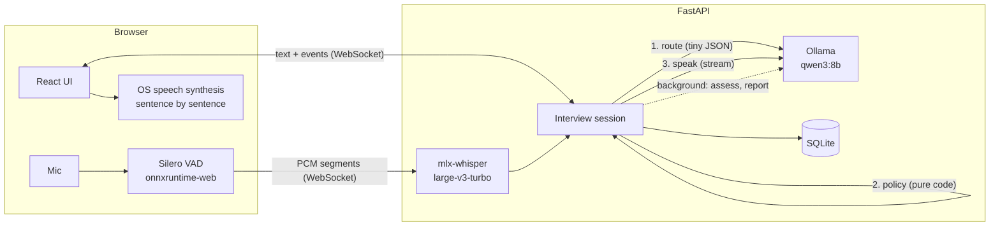

# AI Interview

A realistic mock interviewer that runs **entirely on your own machine**. It reads your resume and the job description, plans a staged interview around them, talks with you by voice, digs into vague answers like a real interviewer, and writes a hiring-committee style debrief at the end.

> 本地运行的 AI 模拟面试官：读简历和 JD 生成面试计划，分阶段语音面试，回答含糊会被连续追问，结束后给出录用建议和逐题复盘。全部在本机运行，简历和录音不会离开你的电脑。

Started as a course project (CUHK IEMS 5709, an edge-computing interview copilot on NVIDIA Jetson; original version at [JJMonsterLin/AI-interview-Copilot](https://github.com/JJMonsterLin/AI-interview-Copilot), imported as the first commit) and rebuilt for Apple Silicon with a focus on how real interviews actually flow.

## What makes it feel like a real interview

| | |
|---|---|
| **Planned, not random** | Resume + JD → candidate profile (projects, claims worth verifying, gaps vs. the JD) → a plan with stages: intro → project deep-dive → technical → behavioral → your questions. Each stage has a time budget that depends on who is interviewing you. |
| **Follow-ups** | Vague answer, no numbers, no personal contribution? The interviewer drills down on the same topic (capped per stage) before moving on. |
| **Natural turn-taking** | Hands-free voice: speech detection in the browser, ~2.5 s of silence submits the answer. Ask "what do you mean?" and it rephrases; ask about the team and it answers, then returns to its open question. |
| **Interviewers differ** | Tech lead / hiring manager / HR, and friendly / neutral / stress-interview styles. |
| **No live scores** | Like a real interview, you get no feedback mid-way. Afterwards: per-answer scores with quotes of your vague claims, a "better answer" hint, per-stage feedback, a hire/no-hire recommendation and three concrete things to practice. |

## Architecture



### Design decisions

- **The LLM judges, code decides.** Each answer gets a small structured *routing* judgement (answer / clarification / don't know / candidate question / off-topic, plus whether to probe). A pure, unit-tested policy turns that into the next move: follow up, clarify, next topic, next stage, answer the candidate, wrap up. Pacing and stage transitions stay predictable; the LLM never "forgets" the agenda.
- **Critical path vs. background work.** Only the tiny routing call sits between you finishing and the interviewer speaking. Detailed scoring runs in the background while you answer the next question, and is cancelled if you answer first (Ollama serves one request at a time; the conversation wins).
- **Instant start.** The interview opens with a templated greeting; profiling and planning run during your self-introduction, which takes longer than planning does.
- **Guardrails on a small model, in code.** Structured outputs are constrained by JSON Schema (Ollama grammar). The spoken reply is streamed sentence by sentence; sentences that just echo the previous question are dropped, and generation is cut after the first question so it never asks three at once. Report structure is normalised in code (one entry per stage, no duplicate advice).
- **Context-biased speech recognition.** Whisper is prompted with technical terms from your resume, the JD and the current question, so mixed Chinese/English answers come out as "Kafka" and "P99" instead of "CAFCA" and "T99".
- **Resumable.** Every turn is persisted; refresh or restart and the interview continues where it stopped, clock included.

### Evaluated, not eyeballed

An [eval harness](backend/evals/README.md) runs the real interview engine against simulated candidates whose behaviour each turn is scripted (solid, vague, off-topic, asks for clarification, doesn't know, asks the interviewer), so every decision has a ground-truth label. 20 interviews per run; [full results](backend/evals/RESULTS.md).

| | baseline | after eval-driven fixes |
|---|---|---|
| Routing accuracy | 82% | **96%** |
| Follows up vague answers but not strong ones (discrimination) | −1% | **96%** |
| Candidate's questions answered | 73% | **100%** |
| Interviews that reach the end within 14 turns | 15% | **95%** |

The harness also drove the model choice (qwen3:4b is 40% faster but speaks its chain of thought in 83% of replies) and an ablation showing the reply guardrails prevent multi-question turns in 30% of cases.

### Measured on an M5 MacBook (24 GB)

| | |
|---|---|
| Start interview | 0.06 s (plan ready ~35 s later, in the background) |
| You stop talking → interviewer's first sentence | 3.9 s p50, 5.5 s p95 (eval, 189 turns) |
| Speech recognition, 13 s answer | 0.65–1.1 s |
| VAD model init in browser | ~90 ms |

## Run it

Requirements: Apple Silicon Mac, [Ollama](https://ollama.com), [uv](https://docs.astral.sh/uv/), Node 20+.

```bash
ollama pull qwen3:8b
cd backend && uv run python scripts/download_asr_model.py   # Whisper weights (from ModelScope, checksum-verified)
cd .. && ./scripts/start.sh                                   # http://localhost:8000
```

Use Chrome or Safari and allow the microphone. Headphones are recommended so the interviewer's voice isn't picked up by the mic. Text mode works without any speech models.

For better voices, install a Premium/Enhanced voice in *System Settings → Accessibility → Spoken Content*; it is picked up automatically.

### Development

```bash
cd backend && uv run uvicorn app.main:app --reload --port 8000
cd frontend && npm install && npm run dev                     # http://localhost:5173
cd backend && uv run pytest
cd backend && uv run python -m evals.run --quick --name smoke   # interviewer evals (see backend/evals)
```

Configuration (environment variables): `LLM_MODEL` (default `qwen3:8b`), `OLLAMA_URL`, `ASR_MODEL` (local folder or Hugging Face repo id), `MAX_FOLLOW_UPS`, `DB_PATH`.

## Project layout

```
backend/app/
  interview/
    models.py     data model + LLM output schemas
    planner.py    resume/JD -> profile -> staged plan
    policy.py     next-move decision (pure code, unit tested)
    prompts.py    all prompts (routing, assessment, speaker, report)
    session.py    turn pipeline, guardrails, background assessment, report
  asr.py          mlx-whisper with vocabulary biasing
  llm.py          Ollama client (structured + streaming)
  main.py         REST + WebSocket API
backend/evals/    simulated candidates, metrics, comparison and error analysis
frontend/src/
  pages/          Setup, Interview, Review, History
  voice/          VAD microphone hook, streaming speaker
```
